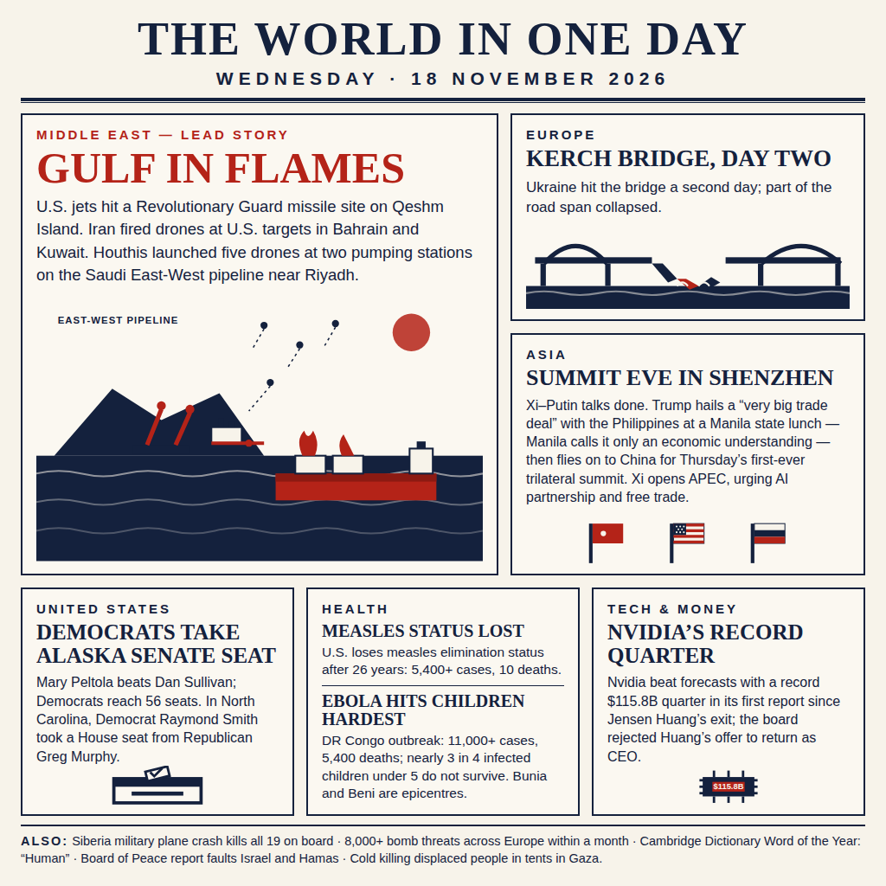

# The World in One Day — 18 November 2026

[](https://make.fun/bounty/news-image-20261118?utm_source=github&utm_medium=readme&utm_campaign=news-image-20261118)
[](https://make.fun/bounty/news-image-20261118/leaderboard?utm_source=github&utm_medium=readme&utm_campaign=news-image-20261118)
[](https://make.fun/bounty/news-image-20261118?utm_source=github&utm_medium=readme&utm_campaign=news-image-20261118)

This refresh sums up the FULL day of Wednesday 18 November 2026 in one image — the first version of this entry covered the morning only, so this version rebuilds the front page with the whole day's news, from the Gulf strikes to the evening's summit eve in Shenzhen.



The entry image is 1024 × 1024 px and 224,453 bytes.

## What the image shows

1. **GULF IN FLAMES:** U.S. jets hit a Revolutionary Guard missile site on Qeshm Island; Iran fired drones at U.S. targets in Bahrain and Kuwait; Houthis launched five drones at two pumping stations on the Saudi East-West pipeline near Riyadh.
2. **KERCH BRIDGE, DAY TWO:** Ukraine hit the bridge a second day; part of the road span collapsed.
3. **SUMMIT EVE IN SHENZHEN:** Xi–Putin talks done; Trump hails a "very big trade deal" with the Philippines at a Manila state lunch, Manila calls it only an economic understanding, then flies on to China for Thursday's first-ever trilateral summit; Xi opens APEC urging AI partnership and free trade.
4. **DEMOCRATS TAKE ALASKA SENATE SEAT:** Mary Peltola beats Dan Sullivan; Democrats reach 56 seats; Democrat Raymond Smith took a North Carolina House seat from Republican Greg Murphy.
5. **HEALTH:** U.S. loses measles elimination status after 26 years (5,400+ cases, 10 deaths); Ebola in DR Congo 11,000+ cases, 5,400 deaths, nearly 3 in 4 infected children under 5 do not survive (Bunia and Beni epicentres).
6. **NVIDIA'S RECORD QUARTER:** record $115.8B quarter, first report since Jensen Huang's exit; board rejected Huang's offer to return as CEO.

Siberia military plane crash kills all 19 on board; 8,000+ bomb threats across Europe within a month; Cambridge Dictionary Word of the Year: "Human".

## How to run

Node 22, stdlib only. From this directory:

```sh
mkdir -p out && MAKEFUN_OUTPUT_DIR=out node main.ts
```

This writes `out/entry.png`, byte-identical to `entry.png`.

## License

MIT — see LICENSE.
